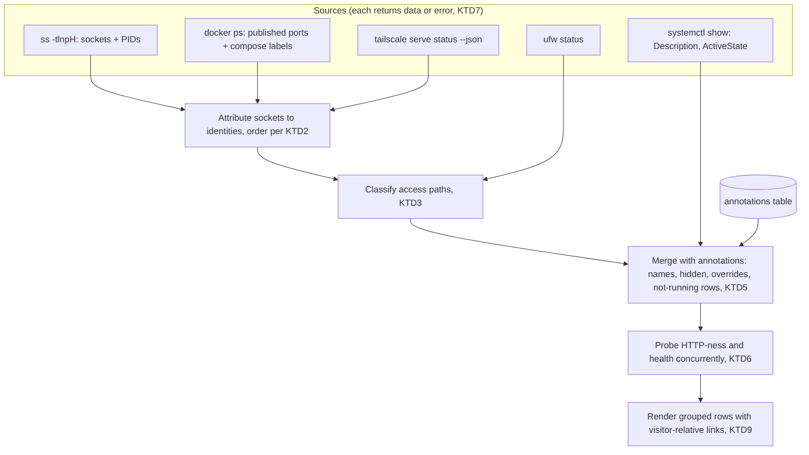
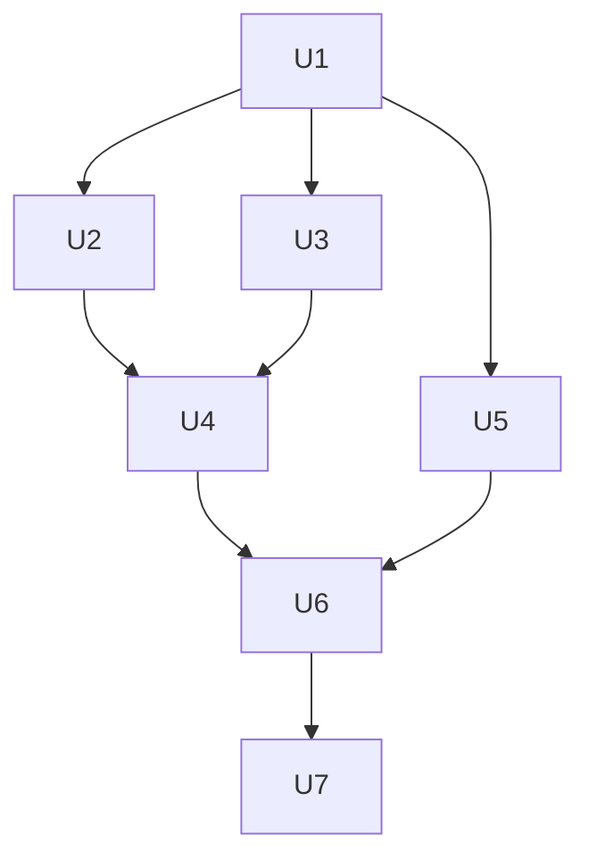

# Z2 Landing Page with Live Service Discovery - Plan

## Goal Capsule

- **Objective:** From any device on the home LAN or the tailnet, opening the Z2's root address shows a current list of what is running on the Z2 and how to reach each service, with links that work.
- **Means:** Extend the existing service-registry app with live, port-first discovery across systemd (system and user), Docker and Tailscale serve, plus a small annotations store (KTD1, KTD2, KTD5).
- **Authority:** Requirements (R) win on product behavior. KTDs win on mechanism within their cited Rs. Units override neither.
- **Stop conditions:**
  - Stop and report if root-run `ss -tlnp` on the Z2 does not expose PIDs for user-unit listeners such as port 8772. Socket-to-unit attribution (KTD2) depends on it.
  - Stop before U7 deploy if the user declines the firewall change in Open Questions. Without it, R1 cannot be met from the LAN.
- **Execution profile:** One PR to `CAPeddle/service-registry`. Build in a separate worktree, never in the live checkout at `/home/cpeddle/service-registry`, which serves production and holds the only copy of 13 unpushed commits.
- **Who finishes:** The implementer lands U1-U7 and opens the PR once the push gate in Open Questions clears. Before U2 starts, the user captures root `ss -tlnp` and `ufw status` output on the Z2 for the fixtures. U2 and U4 cannot finish without it. The user also runs the sudo-only deploy steps in U7 (nginx, ufw, unit restart) and the live checks in the Verification Contract.

---

## Product Contract

### Summary

The Z2 already runs the service-registry app that the pi5 used to host, but its landing page is close to empty and unreachable from the LAN. This plan turns it into a live inventory. Each page load reads what is actually listening on the Z2 and attributes every port to its owner (a system unit, user unit, Docker container or Tailscale serve mapping). It then shows how each service can be reached, with links built from the address the visitor used. A small annotations store keeps the user's names, descriptions, hidden rows and health paths. nginx and the firewall are adjusted so every address that reaches port 80 lands on the page.

### Problem Frame

The registry moved to the Z2 (192.168.2.48) with the rest of the pi5's workload. It still runs (root systemd unit, 127.0.0.1:8000, behind nginx), but it no longer serves its purpose:

- LAN devices cannot load it. ufw blocks port 80 from the LAN: `/var/log/ufw.log` shows `[UFW BLOCK]` for 192.168.2.111 to port 80 on 17 and 21 Nov, and port 8001 (finance-tracker) is blocked too.
- Any Host other than `192.168.2.48` (`z2`, the Tailscale IP, `z2.local`) gets the nginx welcome page. The `default` site holds `default_server` and the registry vhost matches only `server_name 192.168.2.48`.
- The page shows only the two rows marked as approved by hand. finance-tracker's Visit link points at the pi5's old address `http://192.168.2.24:8001`. ah-connector's points at loopback.
- Discovery only reads system-level systemd units, and only when someone clicks Scan (last run 2026-01-23). Most of what now runs on the Z2 is invisible to it: user units (groceries-web, ntfy, garmin-mcp-*, ah-connector), Docker containers (clockme, awcp) and Tailscale serve endpoints.

### Key Decisions

- **Extend the existing app rather than replace it.** It already has the health checks, the API and the deployment. (session-settled: user-approved — chosen over a simpler static or generated page: keeps the scan and health features) Governs R3-R14.
- **List everything detected automatically.** The 2025 approve-before-it-appears gate is dropped, and hiding replaces it as the noise control. (session-settled: user-approved — chosen over keeping the 2025 approval gate: the request asks for a page that lists the running services) Governs R3, R7.
- **"Available" means reachability.** Each running service shows how it can be reached. The old status types (raw/discovered/configured) are not what the page reports any more. (session-settled: user-approved — chosen over "installed but stopped": the page is a click-through to what is up) Governs R4, R8.
- **The tailnet entry point is plain HTTP at `http://z2/`.** awcp already owns `https://z2.tail50309e.ts.net/` through Tailscale serve, and this plan leaves it there. Governs R1.

### Requirements

**Access**

- R1. The landing page loads at `http://192.168.2.48/` from LAN devices, and at `http://z2/`, `http://100.65.192.115/` and `http://z2.tail50309e.ts.net/` from tailnet devices.
- R2. Every request to port 80 reaches the registry, whatever its Host header. No nginx default page.

**Listing**

- R3. The page lists every service with a listening TCP socket on the Z2, whether a system unit, user unit or Docker container runs it, without an approval step.
- R4. Each row shows each way the service can be reached: LAN, tailnet only, blocked by the firewall, internal only, or unknown when a source failed (KTD3).
- R5. Links are built from the address the visitor browsed to, or from the Tailscale serve URL for tailnet-fronted services. Never from a stored IP.
- R6. A port gets a clickable link only when it answers HTTP or the user set a link. Other ports show `host:port` as text.
- R7. Infrastructure noise is hidden by default (the suppression list in KTD2). The user can hide or unhide any row and can show hidden rows on demand.
- R8. A service the user has annotated but that is not listening shows as not running, with its unit state (failed, inactive, active without a port, or not found).
- R9. From the page, the user can set a row's display name, description, link override and health path.

**Freshness and resilience**

- R10. The page reflects the Z2's current state within about 10 seconds, and a refresh control bypasses the cache.
- R11. When one discovery source fails, the page still renders the rest and names the failed source. Rows that source would have classified show "unknown" instead of a wrong class.
- R12. The page renders within about 3 seconds even when probed services hang.

**Compatibility and safety**

- R13. `POST /api/services` keeps accepting its current request shape (the documented registration path ah-connector used) and records the registration as an annotation.
- R14. The two existing approved entries carry over: their descriptions, and ah-connector's `/health` path. finance-tracker's pi5 URL is dropped.
- R15. Running the test suite never reads, alters or deletes the live `service_registry.db`.

### Success Criteria

- From a phone on the LAN, `http://192.168.2.48/` lists groceries-web and ntfy with links that open. finance-tracker is listed with a "LAN blocked by firewall" label and its tailnet link, unless the user opens port 8001. clockme and awcp appear with tailnet links. The garmin-mcp-* services and ah-connector appear as internal only. sshd, DNS and tailscaled do not appear unless hidden rows are shown.
- No row anywhere links to `192.168.2.24` or `127.0.0.1`.
- From a tailnet device, `http://z2/` shows the same list.

### Scope Boundaries

- No login, no LAN HTTPS, no multi-host inventory.
- awcp keeps `https://z2.tail50309e.ts.net/`. The registry is not moved onto Tailscale serve.
- Opening firewall ports for individual services is not part of this plan. The page reports "blocked by firewall", and the user decides.
- UDP listeners, Unix-socket-only interfaces and Docker containers with no published port are not listed.

**Considered and not built:**

- *Parsing nginx vhosts to detect nginx-fronted services.* The registry itself is the only such service today, and it is suppressed. A link override covers future cases. Build this if a second nginx-fronted service appears.
- *A "public via Funnel" reachability class, and parsing `TCPForward` serve entries.* No serve entry uses either today. Add them when they show up in `tailscale serve status --json`.
- *A JSON inventory endpoint (`GET /api/discovered`).* Nothing consumes it. Add it when a script or agent needs the inventory.
- *A warning row for Tailscale serve mappings with no listener.* Today's one case (`:8765 -> 0.0.0.0:8766`) is a stale config the user can remove with `tailscale serve`. Add the row if dead mappings keep appearing.
- *Dropping the unit from root to an unprivileged user.* Root is what lets discovery see every socket's PID, read ufw rules and query user units. Revisit if the app ever accepts writes from outside the LAN or tailnet.
- *Background polling and failure notifications.* Live reads on page load meet R10. ntfy already exists if alerts are wanted later.

### Deferred to Follow-Up Work

- Retire the old `services` table and its 175 raw rows after the import (KTD5) has run in production for a while.

---

## Planning Contract

### Key Technical Decisions

- KTD1. **Live discovery on each page load, behind an in-process cache of about 10 seconds.** The persisted scan-and-approve model is replaced. Staleness is what broke the page (pi5 URLs, a January scan), and a live read on this host is a few fast local commands.
- KTD2. **Port-first discovery, with a fixed attribution order and a suppression list.**
  - The sources are `ss -tlnpH` (sockets and PIDs), `docker ps` with labels (published ports to compose project and service), `tailscale serve status --json` (tailnet URL to local target), `ufw status` (firewall), and `systemctl show` for unit Description and state. User units are queried through `systemctl --user -M <user>@`.
  - **Attribution order:**
    1. The Docker published-port map. docker-proxy PIDs otherwise attribute to `docker.service`.
    2. The Tailscale serve fold-in. tailscaled's front-end ports (443, 8443, 8765) become tailnet access paths on the backend row, not rows of their own.
    3. The PID's `/proc/<pid>/cgroup` unit: `system.slice/<x>.service` or `user@<uid>.service/.../<x>.service`.
    4. Anything left over (transient scopes such as `tmux-spawn-*.scope`, PIDs that cannot be attributed) goes to an "other processes" group that is hidden by default.
  - **Default suppression list:** ports 22 and 53, tailscaled peerapi ports, nginx :80, the registry's own 127.0.0.1:8000, and ephemeral-range listeners at 32768 and above with no unit.
  - Dual-stack sockets on the same port collapse into one access path.
  - **Serve mappings with no listener** (today `:8765 -> 0.0.0.0:8766`) produce no row.
- KTD3. **Reachability comes from the bind address, then the fronts, then the firewall.**

  | Bind address | Fronted by Tailscale serve | ufw allows the port from the LAN | Access paths shown |
  |---|---|---|---|
  | `0.0.0.0`, `::`, `*`, `192.168.2.48` | any | yes | LAN link `http://<visitor host>:<port>` |
  | same | any | no | LAN, blocked by the firewall (text, no link) |
  | `0.0.0.0`, `::`, `*` | any | any | also a tailnet link `http://z2.tail50309e.ts.net:<port>` |
  | `100.65.192.115` or Tailscale IPv6 only | no | n/a | tailnet link `http://z2.tail50309e.ts.net:<port>` |
  | `127.0.0.1`, `::1`, bridge or link-local | yes | n/a | tailnet link with the serve URL (always the MagicDNS name) |
  | same | no | n/a | internal only (text) |
  | `127.0.0.1`, `::1` | Tailscale source failed | n/a | unknown (R11) |
  | `0.0.0.0`, `::`, `*`, `192.168.2.48` | any | ufw source failed | LAN path unknown (R11) |

  Wildcard binds always get a tailnet path. tailscaled runs with `NetfilterMode: 2`, so its `ts-input` chain accepts tailscale0 traffic before ufw sees it (nginx served 100.106.232.78 on :80 while ufw blocked :80 from the LAN). Docker-published ports skip the ufw column, because Docker's DNAT bypasses ufw INPUT rules. Every Docker-published port on Z2 today is bound to 127.0.0.1, so that case does not arise yet. 8001, 8080 and 8090 are bound to all interfaces, so the firewall column applies to them. LAN visitors see tailnet links too, labelled "tailnet only".
- KTD4. **Identity keys are namespaced:** `system:<unit>`, `user:<uid>:<unit>`, `docker:<compose project>/<compose service>` (falling back to the container name), and `manual:<name>` for registrations that match nothing discovered. A key names one service even when it has several ports. The row shows a primary port (set by annotation, else the lowest port that answers HTTP) and lists the others.
- KTD5. **Annotations live in a new table, filled once from the old one.** startup's `create_all` creates new tables but never alters existing ones, and the repo has no alembic setup, so columns added to `services` would never reach the live database.
  - **Fields:** identity key, display name, description, hidden flag, link override, health path, primary port.
  - **Import at startup:** a one-time, idempotent import copies the CONFIGURED rows. finance-tracker maps to `system:finance-tracker.service` with its description and no base URL. ah-connector maps to `user:1000:ah-connector.service` with its description and `/health`.
  - The old `services` table is left untouched.
- KTD6. **Probes target `127.0.0.1:<port>` from the server, run concurrently under a shared budget.**
  - **Is it HTTP?** Any HTTP response to `GET /` within 0.5 s counts. The result is cached with the source results (KTD1), so link-versus-text stays within R10's freshness.
  - **Health:** checked only when a health path is annotated. The result is cached for the existing 60 s TTL.
  - **Budget:** all probes for one page load share a total of about 1.5 s. A probe that runs past the budget renders as "checking failed".
  - A single shared `HealthCheckService` replaces the instance created on every request, whose cache never got a hit. httpx is already a dependency.
- KTD7. **Each source returns data or an error and never raises into the request.** Commands run with fixed argument lists, no shell and a 2 s timeout. The page header names any failed source (R11).
- KTD8. **nginx: the registry vhost becomes the `default_server` on `[::]:80` and `0.0.0.0:80` with `server_name _`, and the `default` site is disabled.**
  - The vhost file and the unit file are tracked under `deploy/` in the repo.
  - ufw gets `allow from 192.168.2.0/24 to any port 80 proto tcp`. Tailnet traffic to :80 already reaches nginx (an access from 100.106.232.78 is logged on 16 Oct).
  - All three changes are user-run sudo steps.
- KTD9. **Inline management replaces the `/scan` page.**
  - The landing page groups rows into Web (LAN), Tailnet, Internal, Not running, and a collapsed Hidden group.
  - Each row has an edit control (name, description, link override, health path, primary port) and a hide toggle.
  - **Placement:** a row appears once, in the group of its best working path: LAN link, then tailnet link, then internal. A row whose LAN path is blocked by the firewall shows that as a label in whichever group it lands in. Rows with an unknown class (R11) sit in an Unknown group at the top. The "other processes" group sits inside Hidden.
  - Rows stack into a single column below about 600px wide, because a phone on the LAN is the main way the page is used.
  - It keeps the existing Jinja2 template and the vanilla-JS modal flow from `src/api/templates/scan.html`, with one change. Row values reach the modal through Jinja-escaped `data-*` attributes read with `element.dataset`, never through values interpolated into inline `onclick` JavaScript. Names and descriptions are now user-writable, and the existing `onclick="openConfigModal('{{ service.name }}', …)"` pattern is a stored-XSS sink because the browser decodes `&#39;` back to `'` before the handler runs. No new frontend dependencies.
- KTD10. **Retire the scan workflow, and repoint `/api/services` at annotations.**
  - `/scan`, `POST /api/scan`, `SystemdDiscovery`, `PortDetection` and the raw/discovered statuses are removed.
  - `/api/services` keeps its request schema (`ServiceCreate` / `ServiceUpdate` in `src/api/schemas/service_schema.py`).
  - **Matching a `name`:** first against discovered identities (unit name, container name, compose service). If nothing matches, the registration becomes `manual:<name>`, with `base_url` as its link override.
  - The wildcard `CORSMiddleware` (`allow_origins=["*"]`) is removed from `src/api/main.py`. This plan opens the unauthenticated write API to the LAN, and the wildcard would let any web page in a LAN or tailnet browser rewrite links or hide rows. The page's own JS is same-origin, and registrations such as ah-connector's call from servers, so nothing the plan needs depends on it.
- KTD11. **Tests run against their own database.**
  - `tests/conftest.py` sets `DATABASE_URL` to a per-session temporary SQLite file before `src.config` is first imported.
  - The three modules that call `drop_all(bind=engine)` (`tests/integration/test_scan_api.py`, `tests/integration/test_services_api.py`, `tests/unit/test_service_model.py`) then act only on that file.
  - Today they act on `sqlite:///./service_registry.db` relative to the working directory, which is the live database when run from the deployed checkout.

### High-Level Technical Design

Discovery pipeline for one page load. Each source result is cached per KTD1, and annotations are applied after the cache, so edits show immediately.

### Sequencing

U1 comes first because nothing else may run tests until the live database is safe. U2 and U3 are independent. U4 needs both. U5 is independent of U4 but lands before U6. U7 is last because its deploy steps need the merged code.

### Assumptions

- The Z2's username for user units is `cpeddle` (uid 1000). It is read from the cgroup path at runtime, never hard-coded.
- The live unit runs `/home/cpeddle/service-registry/.venv`. Both `.venv/` and `venv/` exist in the checkout, so U7 confirms which one has the dependencies installed.

---

## Implementation Units

### U1. Isolate tests from the live database and secure unpushed work

- **Goal:** Make the suite safe to run anywhere (R15), and make sure the 13 unpushed commits and the uncommitted `CLAUDE.md` edit reach the PR branch.
- **Requirements:** R15.
- **Dependencies:** none.
- **Files:** `tests/conftest.py`, `tests/integration/test_scan_api.py`, `tests/integration/test_services_api.py`, `tests/unit/test_service_model.py`, `tests/unit/test_test_isolation.py` (new), `.gitignore`.
- **Approach:**
  1. Base the worktree branch on local `master` from the live checkout, which includes the 13 unpushed commits, not on `origin/master`.
  2. Carry the live checkout's uncommitted `CLAUDE.md` edit into the branch. It removes pi5-era SSH deploy steps.
  3. Add `.venv/`, `venv/` and `*.backup` to `.gitignore`.
  4. Isolate the database per KTD11.
- **Execution note:** Land this before anything runs the suite. Do not run pytest from `/home/cpeddle/service-registry` at any point.
- **Patterns to follow:** the in-memory `db_session` fixture already in `tests/conftest.py`.
- **Test scenarios:**
  - During the test session, `settings.database_url` does not resolve to `<repo>/service_registry.db` or to `/home/cpeddle/service-registry/service_registry.db`.
  - A sentinel `service_registry.db` in the working directory is unchanged after the full suite runs: same size, same hash.
- **Verification:** The full suite passes in the worktree, and the live database's modification time is unchanged afterwards.

### U2. Discovery sources

- **Goal:** One module per source. Each turns raw command output into typed records, or returns an error (KTD2, KTD7).
- **Requirements:** R3, R4, R11.
- **Dependencies:** U1.
- **Files:** `src/services/discovery/__init__.py`, `src/services/discovery/sockets.py`, `src/services/discovery/cgroups.py`, `src/services/discovery/docker_ports.py`, `src/services/discovery/tailscale_serve.py`, `src/services/discovery/firewall.py`, `src/services/discovery/units.py`, `tests/unit/discovery/test_*.py` (one per source), `tests/fixtures/z2/` (captured outputs).
- **Approach:**
  1. Capture real outputs from the Z2 as fixtures: `ss -tlnpH`, `/proc/<pid>/cgroup` samples for system, user and scope processes, `docker ps` with the compose labels, `tailscale serve status --json`, and `ufw status`. Capture `ss` and `ufw` as root, which the user runs.
  2. Write a pure parser per source, plus a thin runner that executes the command with a timeout and returns data or an error.
  3. The sockets parser keeps the bind address, port and PID, and tolerates lines with no PID.
  4. The Tailscale parser handles `Web` handlers with these proxy forms: `http://127.0.0.1:N`, `0.0.0.0:N`, bare `N`, `localhost:N` and `https+insecure://`.
  5. The firewall parser reports, for each TCP port, whether some ALLOW rule admits 192.168.2.0/24 (from `Anywhere`, a matching subnet, or a matching host).
- **Patterns to follow:** the parse/run split in `src/services/systemd_discovery.py` (`list_services` / `_parse_systemctl_list`) and its tests in `tests/unit/test_systemd_discovery.py`.
- **Test scenarios:**
  - The `ss` fixture yields 8001 on `0.0.0.0` (PID 1128646), 8090 on `*`, 8772 on `127.0.0.1`, and both families for 80.
  - An `ss` line with no `users:(...)` section yields a socket with no PID, not an exception.
  - The cgroup line `0::/system.slice/finance-tracker.service` maps to `system:finance-tracker.service`.
  - `0::/user.slice/user-1000.slice/user@1000.service/app.slice/groceries-web.service` maps to `user:1000:groceries-web.service`.
  - A `.../tmux-spawn-<uuid>.scope` path maps to "unattributed".
  - The docker fixture maps 127.0.0.1:3000 to `docker:app/app` and 127.0.0.1:8790 to `docker:awcp/awcp`. awcp-db, with no published port, yields nothing.
  - The serve fixture maps `127.0.0.1:8790` to `https://z2.tail50309e.ts.net/`, `127.0.0.1:3000` to `https://z2.tail50309e.ts.net:8443/`, and `0.0.0.0:8766` to `http://z2.tail50309e.ts.net:8765/`.
  - The serve proxy forms `3000` and `localhost:3000` both resolve to port 3000.
  - The firewall output `80/tcp ALLOW IN 192.168.2.0/24` marks 80 as LAN-allowed. With no rule for 8001, 8001 reads as blocked.
  - When the command is missing or exits non-zero (no docker binary, tailscaled stopped, `ufw` without root), the runner returns an error result naming the source.
  - When a command runs past its timeout, the runner returns an error result and does not hang.
- **Verification:** Every parser has fixture-backed tests. The runners never raise.

### U3. Annotations store and one-time import

- **Goal:** Persist the user's per-service choices under stable identity keys, and carry over the two existing approved entries (KTD4, KTD5).
- **Requirements:** R7, R9, R14.
- **Dependencies:** U1.
- **Files:** `src/models/annotation.py`, `src/models/__init__.py`, `src/repositories/annotation_repository.py`, `src/core/database.py`, `tests/unit/test_annotation_repository.py`, `tests/unit/test_annotation_import.py`.
- **Approach:**
  1. Add the annotation model with a unique identity key.
  2. Add a repository with get, upsert, list and set-hidden operations.
  3. After `create_all`, `init_db` runs the import. It runs only when the annotations table is empty and the `services` table exists.
  4. Map the old service names to identity keys. A CONFIGURED row whose `systemd_state` is `unknown` was registered through the API (as ah-connector was). Resolve it to a user unit when the name exists under `user@1000.service`, else to `manual:<name>`.
- **Patterns to follow:** `src/models/service.py` (declarative model, UTC timestamps) and `src/repositories/` (currently empty, intended for data access).
- **Test scenarios:**
  - An old DB with finance-tracker (CONFIGURED, `base_url` `http://192.168.2.24:8001`) imports as `system:finance-tracker.service`, with its description and no link override.
  - An old DB with ah-connector (CONFIGURED, `systemd_state` `unknown`, health `/health`) imports as `user:1000:ah-connector.service`, with its description and health path.
  - A second startup creates no duplicates and leaves user edits made after the first import alone.
  - A fresh DB with no `services` table starts cleanly with zero annotations.
  - Old RAW and DISCOVERED rows are not imported.
  - Upserting an existing key updates it in place. Setting hidden on an unknown key creates a minimal annotation.
- **Verification:** A copy of the live database put through `init_db` yields exactly two annotations, matching the scenarios above.

### U4. Inventory: attribution, classification and merge

- **Goal:** Turn source results plus annotations into the row model the page renders (KTD2, KTD3, KTD4), behind the cache from KTD1.
- **Requirements:** R3, R4, R5, R7, R8, R10, R11.
- **Dependencies:** U2, U3.
- **Files:** `src/services/discovery/inventory.py`, `src/services/discovery/cache.py`, `src/api/dependencies/services.py`, `tests/unit/discovery/test_inventory.py`, `tests/unit/discovery/test_inventory_z2_golden.py`.
- **Approach:**
  1. Attribute sockets in the KTD2 order and collapse dual-stack sockets.
  2. Classify each access path per KTD3. Links stay host-relative placeholders here, resolved at render time from the visitor's host.
  3. Apply the suppression list and hidden flags.
  4. Add a not-running row for each annotated identity with no listener, with its state from `systemctl show` (R8).
  5. Cache source results for about 10 s with a bypass flag. Annotations are read fresh on every request.
- **Technical design (directional):** a row carries identity, display name, description, origin type (system, user, docker, manual), state (running, running without a port, failed, inactive, not found, unknown) and one or more access paths. An access path carries port, class and link.
- **Patterns to follow:** dependency injection in `src/api/dependencies/services.py`, so tests can override sources.
- **Test scenarios:**
  - The golden test feeds the full Z2 fixture set from U2. Expected visible rows:
    - finance-tracker: LAN blocked by firewall under the captured rules, plus a tailnet link on 8001
    - groceries-web: LAN
    - ntfy: LAN
    - clockme (`docker:app/app`): tailnet link on 8443
    - awcp: tailnet link on 443
    - garmin-mcp-proxy, garmin-mcp-power-proxy, garmin-mcp-backend, garmin-mcp-power-backend, garmin-mcp-rate-limiter and ah-connector: internal
  - The golden test's expected hidden rows are sshd, systemd-resolved, tailscaled (peerapi ports), nginx, service-registry and the tmux scope.
  - The 8765 serve mapping, which has no listener, produces no row.
  - A docker-proxy socket in the `docker.service` cgroup is attributed to its container, never to `docker.service`.
  - tailscaled's 443 and 8443 appear only as access paths on their backend rows.
  - An annotated identity with no socket whose unit is `failed` shows state failed in the Not running group.
  - An annotated `manual:<name>` with a link override shows as a row with that link and state "unknown".
  - With the Tailscale source failed, 127.0.0.1-bound rows show "unknown", not internal, and the result carries the source error.
  - With the Docker source failed, docker-proxy sockets show as unknown, not as `docker.service`.
  - A second call within the cache window does not re-run the sources. A call with the bypass flag does.
  - An annotation edit made between two cached calls is visible on the second call.
- **Verification:** The golden test passes against the captured Z2 fixtures. No row's link contains a literal IP from storage.

### U5. Concurrent HTTP and health probes

- **Goal:** Decide which ports get links, and run opt-in health checks without slowing the page (KTD6).
- **Requirements:** R6, R12.
- **Dependencies:** U1.
- **Files:** `src/services/health_check.py`, `src/api/dependencies/services.py`, `tests/unit/test_health_check.py`.
- **Approach:**
  1. Make one module-level probe service. "Is HTTP" results share the source cache (KTD1), and health results keep the 60 s cache.
  2. Run all probes for a page load concurrently, under the shared budget.
  3. Probe only `127.0.0.1`, built from the port, never from a stored base URL.
- **Patterns to follow:** the existing `HealthStatus` dataclass and `check_health` cache logic in `src/services/health_check.py`.
- **Test scenarios:**
  - A port that answers HTTP 404 on `/` counts as HTTP. A port that resets the connection, or answers non-HTTP bytes, does not.
  - A health path returning 200 reads healthy. A 500 reads unhealthy. No health path reads as not checked.
  - With 15 probes whose targets each hang for 5 s, the batch returns within the budget plus a small margin, with those probes marked "checking failed".
  - Two page loads within the cache window run each probe once.
  - Probe URLs never contain a host other than `127.0.0.1`.
- **Verification:** The hang test passes within about 2 s. Coverage of `src/services/health_check.py` stays at or above the `--cov-fail-under=80` gate.

### U6. Landing page, inline management and API retarget

- **Goal:** Render the grouped live inventory with visitor-relative links, add edit and hide controls, retire the scan workflow, and keep `/api/services` working (KTD9, KTD10).
- **Requirements:** R3-R11, R13.
- **Dependencies:** U4, U5.
- **Files:**
  - Modify: `src/api/routes/pages.py`, `src/api/templates/index.html`, `src/api/templates/base.html`, `src/api/routes/services.py`, `src/api/schemas/service_schema.py`, `src/api/main.py`.
  - Delete: `src/api/routes/scan.py`, `src/api/templates/scan.html`, `src/services/registry_service.py`, `src/services/systemd_discovery.py`, `src/services/port_detection.py`, and their now-obsolete tests (`tests/integration/test_scan_api.py`, `tests/unit/test_registry_service.py`, `tests/unit/test_systemd_discovery.py`, `tests/unit/test_port_detection.py`).
  - Tests: `tests/integration/test_landing_page.py`, `tests/integration/test_services_api.py`.
- **Approach:**
  1. Resolve link placeholders at render time from `get_safe_hostname`. Extend it to accept bracketed IPv6 literals while keeping its injection guard.
  2. Show failed sources in a header banner, and add a refresh control that bypasses the cache.
  3. Edit and hide controls call `/api/services`, which now upserts annotations by identity per KTD10. Row values reach the controls through `data-*` attributes (KTD9).
  4. Remove the wildcard CORS middleware from `src/api/main.py` (KTD10).
- **Patterns to follow:** the modal and `fetch` flow in the current `scan.html`, the dependency overrides used in `tests/integration/test_services_api.py`, and `get_safe_hostname` in `src/api/routes/pages.py`.
- **Test scenarios:**
  - With the inventory overridden by the Z2 golden rows and `Host: 192.168.2.48`, groceries-web links to `http://192.168.2.48:8080`. With `Host: z2`, it links to `http://z2:8080`.
  - Under any Host, awcp links to `https://z2.tail50309e.ts.net/` with a "tailnet only" label.
  - Internal rows (ah-connector) render `127.0.0.1:8772` as text, with no anchor.
  - A LAN row blocked by the firewall renders the port as text with a "blocked by firewall" label.
  - A port marked non-HTTP gets no anchor even when bound LAN-wide.
  - Hidden rows are absent by default, and appear under a Hidden group when the show-hidden toggle is set.
  - A source error from the inventory renders a banner naming it, and the page still returns 200.
  - `Host: [fd4e::1]` produces links using `[fd4e::1]`. A Host containing CR/LF falls back to `localhost`.
  - `POST /api/services` with `{name: "ah-connector.service", description, base_url, health_endpoint: "/health"}` upserts `user:1000:ah-connector.service`.
  - `POST /api/services` with a name matching nothing discovered creates `manual:<name>`, with `base_url` as its link override.
  - A POST with `base_url` lacking `http(s)://` still returns 422 (existing validator).
  - `PUT` on an annotation updates the hidden flag and display name, and the next page render reflects them.
  - `GET /scan` and `POST /api/scan` return 404.
  - A manual registration named `x');alert(1);//` renders with no executable content in any event-handler attribute.
  - A CORS preflight from a foreign `Origin` to `POST /api/services` gets no `Access-Control-Allow-Origin` header.
  - Under any Host, finance-tracker shows its "LAN blocked by firewall" label in the Tailnet group, with the link `http://z2.tail50309e.ts.net:8001`.
- **Verification:** The integration tests pass. A manual render against the live sources on the Z2 matches the Success Criteria.

### U7. Deploy configuration, docs and rollout

- **Goal:** Make every address on port 80 serve the page, open port 80 to the LAN, and update the docs that describe the retired workflow (KTD8).
- **Requirements:** R1, R2.
- **Dependencies:** U6.
- **Files:** `deploy/nginx/service-registry.conf` (new), `deploy/systemd/service-registry.service` (new, mirrors the live unit with the venv path confirmed), `README.md`, `docs/SERVICE_INTEGRATION_GUIDE.md`, `CLAUDE.md`.
- **Approach:**
  1. Write the vhost per KTD8 with the existing proxy headers from `/etc/nginx/sites-available/service-registry`.
  2. Document the user-run steps in `README.md`: install the vhost, remove the `default` symlink, `nginx -t`, reload, add the ufw rule, update the live checkout, restart the unit.
  3. **Updating the live checkout:** a plain `git pull` aborts there. The uncommitted `CLAUDE.md` edit, and this plan file sitting untracked, collide with the merged versions.
     - First confirm `origin/master` contains the 13 formerly local commits and the `CLAUDE.md` edit.
     - Then align the checkout to `origin/master`, discarding its now-merged local copies. The untracked `service_registry.db` and the venvs are untouched by this.
  4. Rewrite the integration guide: services appear automatically, and `/api/services` is for annotation and manual registration with its real field names. The current guide documents `url`/`status` fields the API never accepted.
  5. Remove pi5-era IP references (192.168.2.24 placeholders) from `README.md`, `docs/SERVICE_INTEGRATION_GUIDE.md`, `CLAUDE.md` and the templates.
- **Execution note:** This is mostly configuration. Prove it with live smoke checks from real devices, not unit tests.
- **Test expectation:** none — config and docs. The behavior is covered in U4 and U6, and deployment is checked in the Verification Contract.
- **Verification:**
  - A LAN device and a tailnet device each load the page at every R1 address.
  - `curl` with each Host header against 127.0.0.1 returns the registry, not the nginx default page.

---

## Verification Contract

| Gate | How | Applies to |
|---|---|---|
| Unit and integration suite | `pytest` from the worktree, using the project's venv. `pytest.ini` enforces `--cov-fail-under=80` | U1-U6 |
| Live DB untouched by tests | Live `service_registry.db` modification time and hash, compared before and after the suite runs | U1 |
| Root socket visibility | User runs `sudo ss -tlnp` on the Z2 and confirms PIDs appear for 8772, 8001 and the docker-proxy ports. If they do not, the first Goal Capsule stop condition applies | U2, U4 |
| Golden inventory | `tests/unit/discovery/test_inventory_z2_golden.py` against fixtures captured on the Z2 | U4 |
| Render budget | Probe hang test (U5). After deploy, the page loads in under 3 s from a LAN device | U5, U6 |
| Host coverage | `curl -H 'Host: <h>' http://127.0.0.1/` for `192.168.2.48`, `z2`, `100.65.192.115`, `z2.tail50309e.ts.net` and `z2.local`, each returning the registry title | U7 |
| Real devices | A LAN phone loads `http://192.168.2.48/`, a tailnet device loads `http://z2/`, and both match the Success Criteria | U7 |
| Firewall | `sudo ufw status` shows the port 80 LAN rule, and no new `[UFW BLOCK] ... DPT=80` lines from 192.168.2.x appear in `/var/log/ufw.log` after the rule is added | U7 |

## Definition of Done

- Every R1-R15 is met, and each Verification Contract gate passes or is reported with its output.
- The Success Criteria hold on the live Z2 after the user's deploy steps.
- The PR branch contains the 13 previously unpushed commits and the `CLAUDE.md` edit. The live checkout is back on a clean `master` once the PR has merged.
- No dead code from the retired scan workflow remains, and no abandoned experimental code is left in the diff.
- `README.md`, `docs/SERVICE_INTEGRATION_GUIDE.md`, `CLAUDE.md` and the templates do not reference `192.168.2.24`. Dated files under `docs/plans/` are historical records and stay as they are.

---

## Open Questions

**Gate on opening the PR (user decision, does not block building):**

- Confirm pushing the branch that carries the 13 commits never pushed from the live checkout. The implementer builds U1-U7 but pushes nothing and opens no PR until the user agrees.

**Gate on deploy (user decision, does not block building):**

- Confirm adding the ufw rule `allow from 192.168.2.0/24 to any port 80 proto tcp`. Without it, R1 fails from the LAN. Ports 8001, 8080 and 8090 stay as they are, and the page reports them as blocked if they are.

**Deferred to implementation:**

- The exact `systemctl --user -M cpeddle@ show` invocation and its output when the user manager is not running.
- `ufw status` output variants (numbered rules, v6 duplicates, interface-scoped rules) beyond the fixture captured on the Z2.
- Which of `.venv/` and `venv/` the live unit should run, and whether the other can be deleted.

## Sources and Research

- Original design and decisions: `docs/plans/2025-11-26-service-registry-design.md` and `docs/plans/2025-12-31-clickable-services-design.md`.
- Current discovery and port logic: `src/services/systemd_discovery.py`, `src/services/port_detection.py`, `src/services/registry_service.py` (`scan_services`).
- Health cache defect: `src/api/routes/pages.py` builds a new `HealthCheckService()` per request, so `src/services/health_check.py`'s cache never gets a hit.
- Test hazard: `src/models/base.py` binds `engine` to `settings.database_url` (`sqlite:///./service_registry.db`). Three test modules call `drop_all(bind=engine)`.
- Firewall evidence: `/var/log/ufw.log` `[UFW BLOCK]` entries for SRC=192.168.2.111 to DPT=80 (17 and 21 Nov 2026) and for DPT=8001 in the rotated logs.
- nginx state: `/etc/nginx/sites-enabled/default` (`default_server`, `server_name _`) and `/etc/nginx/sites-enabled/service-registry` (`server_name 192.168.2.48`, IPv4 only).
- Tailscale serve config, from `tailscale serve status --json` on 2026-11-22: 443 → 127.0.0.1:8790, 8443 → 127.0.0.1:3000, 8765 → 0.0.0.0:8766 (no listener).
